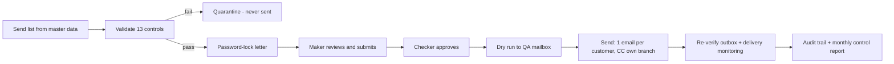
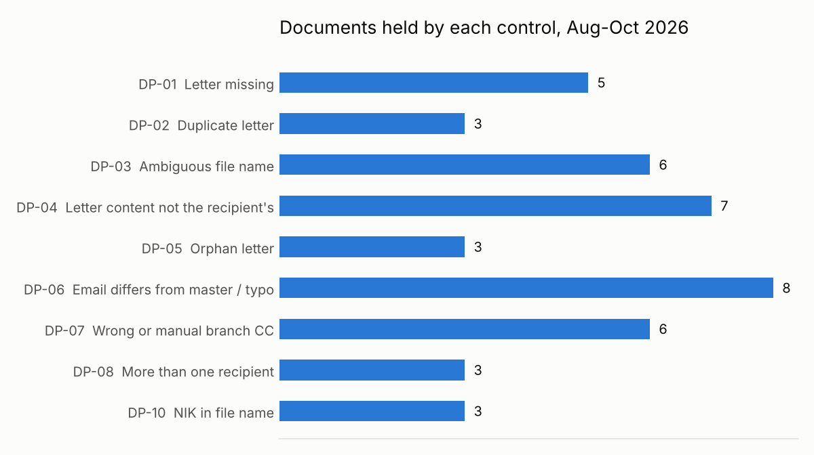
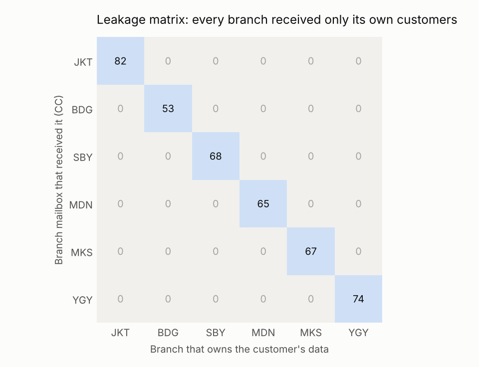
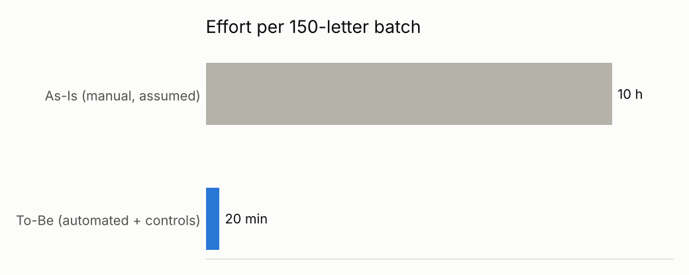

# Secure Customer Correspondence

**Automated customer letter delivery with built-in data protection controls and maker-checker governance.**

Insurers send thousands of letters every month — maturity notices, benefit payment confirmations,
reinstatement notices — by email to the policyholder, with the servicing branch in CC. Every letter
carries personal data, including the customer's **NIK**. When this is done by hand, every step is a
chance for one customer's data to reach someone else.

This project redesigns that process so it is **faster, leak-proof by design, and auditable**:

| Pillar | What it delivers |
|---|---|
| **Business process improvement** | Manual matching, addressing and attaching replaced by an automated pipeline — ~10 hours → ~20 minutes per 150-letter batch |
| **Data protection** | 13 controls ensure each customer receives only their own letter, each branch receives only its own customers, and the NIK never travels unprotected |
| **Governance** | System-enforced maker-checker, kill switch, append-only audit trail, monthly control report, risk & control matrix, RACI, SOP and incident playbook |

> All data is **synthetic** (a fictional insurer, "Nusantara Life"). No real customer, employer or
> production data is used. Every email address — customers, branches, sender — uses the reserved
> `.example` domain (RFC 2606), e.g. `customer.0001@gmail.example`, so nothing can ever reach a real
> person. Names, NIK and addresses are generated and stored **already masked** (`Budi W*****`,
> `3273********0002`, `Jl. M****** No. **`), so the repository holds no full personal value at all.
> Every letter is watermarked **EXAMPLE**, and emails are written to a local outbox, not sent.

---

## How it works



1. **Validate.** Every letter and every recipient is checked before anything is sent.
2. **Quarantine.** Anything that fails is copied (never moved) to quarantine and is never sent.
3. **Lock.** Letters that pass are AES-256 password-protected with the customer's date of birth.
4. **Maker submits.** Staff review the held items and submit; the batch manifest is fingerprinted.
5. **Checker approves.** A *different* person approves. The maker cannot approve their own batch.
6. **Dry run, then send.** One email per customer; the CC goes only to that customer's branch mailbox.
7. **Prove it.** The outbox is re-opened independently and each attachment must open with the
   recipient's own password and contain only the recipient's data.

## Controls

| ID | Control | Severity |
|---|---|---|
| DP-01 | Every customer on the send list has a letter | High |
| DP-02 | No duplicate letters for one customer | High |
| DP-03 | File name points to exactly one policy | High |
| DP-04 | Letter content (policy, name, **NIK**) matches the recipient | Critical |
| DP-05 | No orphan letter without an owner on the send list | High |
| DP-06 | Customer email matches master data and has no domain typo | Critical |
| DP-07 | Branch CC resolved from branch master data and allowlisted | Critical |
| DP-08 | One email = one customer + their own branch, no BCC | Critical |
| DP-09 | Letters containing NIK are password-protected | Critical |
| DP-10 | NIK never appears in file name, subject or email body | High |
| DP-11 | Logs and reports store masked personal data only | High |
| DP-12 | Sent only from the official mailbox; no credentials in code | Critical |
| DP-13 | Attachment is byte-identical to the approved version | Critical |

Plus a **kill switch** (halt if quarantine rate > 20%, any integrity failure, or repeated transport
errors) and **delivery monitoring** (bounces routed to the branch for follow-up).

## Results (simulation, Aug–Oct 2026)

| | |
|---|---|
| Customers in scope | 450 (3 monthly batches) |
| Emails sent | 409 |
| Held before sending | 41 customers + 3 orphan letters |
| Injected defects caught | **44 / 44** |
| Defects that reached a customer | **0** |
| False positives | 0 |
| Unsafe emails in outbox (independent re-check) | **0** |
| Cross-branch exposures | **0** |
| Processing time per batch | ~12 seconds |
| Effort per batch | ~10 h (As-Is, assumed) → ~20 min (To-Be) |

To prove the controls work, realistic mistakes are injected into every batch on purpose — swapped
letters, a foreign NIK, stale and mistyped emails, a wrong branch code, a manual external CC, two
recipients in one cell, a NIK in a file name, duplicate, missing, ambiguous and orphan files — and
recorded in `data/ground_truth_defects.csv`. The control test compares what was held with what was
injected.







## Governance documents

- [Process redesign: As-Is vs To-Be](docs/process_as_is_to_be.md)
- [Risk & Control Matrix](docs/risk_control_matrix.md)
- [RACI and SOP](docs/raci_and_sop.md)
- [Incident playbook (UU PDP, 3 × 24 hours)](docs/incident_playbook.md)
- [Monthly control report](reports/management_summary.md) · [Excel version](reports/monthly_control_report.xlsx)
- [Slide deck](presentation/Secure_Customer_Correspondence.pptx) · [Case study page](docs/case-study/index.html)

## Run it

```bash
pip install -r requirements.txt

# Generate synthetic data and run all three monthly batches end to end
python scripts/run_all.py

# Open the control room (validate -> quarantine -> maker -> checker -> send -> leakage proof -> report)
streamlit run app/streamlit_app.py

# Tests
pytest -q

# Rebuild the slide deck from the latest report
python scripts/export_deck_data.py && node presentation/build_deck.js
```

In the app, switch the **Signed in as** user to play maker (`dina.maker`) and checker
(`sari.supervisor`). Use **Reset this batch** to replay the workflow.

## Repository structure

```
config/settings.json        sender, users, kill-switch thresholds, CC mode, assumptions
src/scc/
  synthetic.py              synthetic customers, branches, send lists, letters, injected defects
  letters.py                PDF rendering and field extraction
  pii.py                    NIK validation, masking, typo detection
  controls.py               pre-send controls DP-01..DP-08, DP-10
  pipeline.py               validate -> lock -> submit -> approve -> send -> monitor (DP-09, DP-13, kill switch)
  mailer.py                 email building, outbox / SMTP transport, sender control (DP-12)
  audit.py                  append-only, masked audit trail
  reporting.py              outbox re-verification, control test, DP-11 scan, monthly report, charts
app/streamlit_app.py        control room UI
scripts/run_all.py          end-to-end run
tests/                      22 tests: one per failure mode, workflow and leakage proof
docs/                       governance documents
docs/case-study/index.html  portfolio case study page (self-contained)
presentation/               slide deck (.pptx) and its generator
reports/                    generated report and charts
```

## Design decisions

- **Branch CC is never typed.** It is resolved from branch master data using the customer's master
  branch code; a manual CC column is treated as a finding, not an input.
- **Copy, never move.** Source folders are left untouched; quarantine and locked folders hold copies.
- **Fingerprint the approval.** The checker approves a specific manifest; any change to it or to an
  attachment afterwards stops the batch.
- **Logs are not a second leak.** Logs and reports hold masked data only, and every run scans them for
  raw NIK, email addresses and birth dates.
- **Configurable CC mode.** `cc` (branch in CC, current practice) or `notice_only` (branch gets a
  notice without the attachment — stricter data minimisation).
- **Safe by default transport.** The default transport writes `.eml` files; SMTP is opt-in and reads
  credentials from environment variables only.

## Assumptions and limitations

- As-Is effort (4 min per letter) and To-Be review time (20 min per batch) are assumptions in
  `config/settings.json`; replace them with a time study.
- Delivery feedback (bounces) is simulated.
- The PDF password (date of birth) follows common practice for Indonesian e-statements; a production
  system could use a one-time code sent by SMS instead.

---

Built by **Yusep Fathul Anwar** — Business Process Improvement, Customer Correspondence.
The design reflects real operational patterns, rebuilt from scratch with synthetic data.
