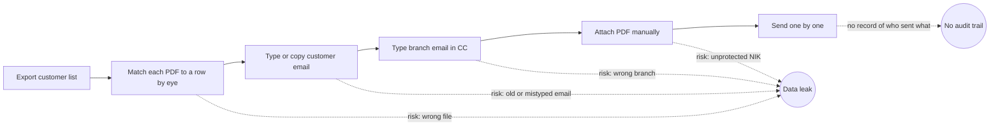
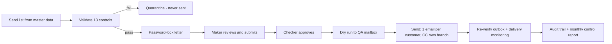

# Process Redesign: As-Is vs To-Be

## As-Is — manual

Pain points
- Every letter is handled by hand: matching, addressing, attaching, sending.
- Each manual step is a chance for a customer's NIK to reach the wrong person.
- No independent review before sending and no reliable record afterwards.

## To-Be — automated, controlled, governed

| | As-Is | To-Be |
|---|---|---|
| Effort per 150-letter batch | ~10 hours (assumption: 4 min per letter) | ~20 minutes (measured ~12 s processing + assumed 20 min review & approval) |
| Wrong-recipient protection | Staff attention | 13 automated controls + independent outbox verification |
| NIK protection | None | Password-locked attachment, NIK never in name/subject/body |
| Review before sending | Ad hoc | Mandatory maker-checker, system-enforced |
| Evidence | None | Audit trail, quarantine register, monthly report |

The As-Is time and the To-Be review time are **assumptions** for this simulation
(`config/settings.json`); replace them with a time study from the real process.
